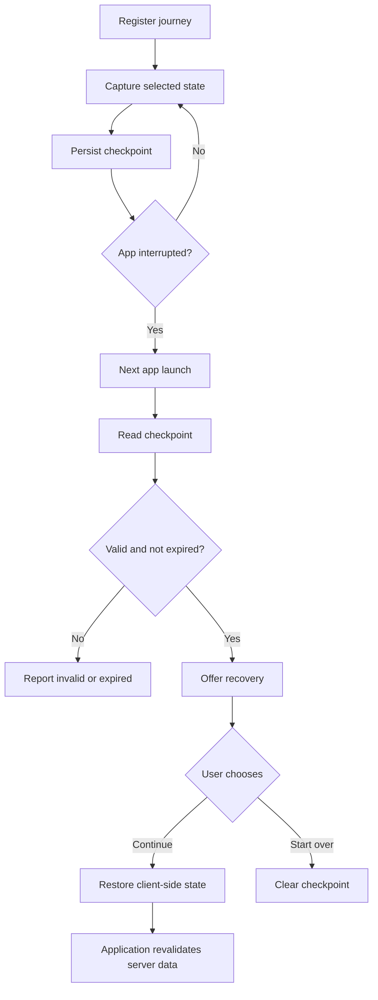

# Product Blueprint: React Native Journey Recovery

> **Product tagline:** Never make users start over.  
> **Package name:** `react-native-journey-recovery`  
> **Platform:** Android and iOS  
> **Primary language:** TypeScript  
> **Product type:** React Native developer library  
> **Document status:** Product and technical planning blueprint

---

## 1. Executive summary

`react-native-journey-recovery` is a developer-first recovery engine for React Native applications. It helps developers save, validate, and restore unfinished user journeys after interruptions such as app termination, crashes, accidental closure, device restarts, or navigation away from a multi-step flow.

The product is not intended to be another generic state-persistence library. Its focus is the **recovery lifecycle of a named user journey**: registration, checkpointing, validation, expiry, restoration, migration, and cleanup.

Examples of journeys include:

- E-commerce checkout
- Multi-step registration and onboarding
- Booking and reservation
- Profile setup
- Document submission
- Loan or insurance applications
- Long forms and content creation

### Product vision

Make interrupted user journeys recoverable through a small, predictable API that works across Android and iOS.

### Core value proposition

> Your users should not have to start over because your app was interrupted.

---

## 2. Problem statement

Mobile applications frequently contain workflows that span multiple screens and require users to enter or select information over time. These workflows can be interrupted when:

1. The user closes the app.
2. Android or iOS terminates the process.
3. The user switches to another app.
4. The device restarts.
5. The app crashes.
6. Connectivity is lost.
7. The user accidentally navigates away.
8. The app is upgraded while a journey is in progress.

Developers often have to assemble their own solution from storage, navigation persistence, form state, validation, expiry handling, and migration logic.

These pieces solve related but separate problems. The product opportunity is to provide a unified recovery layer with explicit journey semantics.

### Important distinction

The library restores **client-side progress and context**. It does not prove that a server-side action succeeded. Prices, stock, booking availability, authentication, payment status, and transaction status must be revalidated by the application.

---

## 3. Target users

| Audience | Problem |
|---|---|
| React Native developers | Repeatedly implementing recovery logic |
| Small and medium app teams | Losing users during multi-step workflows |
| E-commerce developers | Abandoned checkout forms |
| Fintech developers | Interrupted applications |
| Booking platforms | Lost reservation progress |
| SaaS developers | Lost unsaved work |

### Primary audience

Individual React Native developers and small-to-medium development teams who want to add recovery without adopting a large state-management or persistence framework.

---

## 4. Product principles

1. **Developer-controlled:** developers explicitly decide what data is captured.
2. **Safe by default:** do not serialize the entire application state automatically.
3. **Framework-independent core:** the core must not require a navigation or form library.
4. **Incremental persistence:** checkpoints are saved during the journey, not only when the app closes.
5. **Validated restoration:** never blindly trust a stored snapshot.
6. **Small adoption surface:** basic recovery should require only a few API calls.
7. **Adapter-based integrations:** navigation, forms, and storage integrations remain optional.
8. **No backend dependency:** the core library must work locally without a hosted service.

---

## 5. Product scope

The product should be divided into three layers.

### 5.1 Core engine

| Feature | Description | Priority |
|---|---|---|
| Journey registration | Define a named recoverable journey | P0 |
| Checkpoint storage | Persist journey progress incrementally | P0 |
| Restore API | Retrieve and validate a checkpoint | P0 |
| Journey expiry | Invalidate old checkpoints | P0 |
| Manual checkpoint | Save at important user actions | P0 |
| Recovery lifecycle | Events for save, restore, discard, and failure | P0 |
| Data validation | Validate snapshots before restoration | P0 |
| Schema versioning | Track journey data schema versions | P0 |
| Auto-save | Optional debounced persistence | P1 |
| Checkpoint history | Restore an earlier checkpoint | P2 |

### 5.2 Integration adapters

| Integration | Purpose | Priority |
|---|---|---|
| AsyncStorage | Default persistent storage | P0 |
| Custom storage | Bring-your-own storage implementation | P0 |
| React Navigation | Save and restore navigation context | P1 |
| MMKV | Optional fast storage adapter | P1 |
| Expo Router | Route context integration | P1 |
| React Hook Form | Form state integration | P1 |
| Formik | Form state integration | P2 |
| Redux | State integration | P2 |
| Zustand | State integration | P2 |
| TanStack Query | Optional coordination with server cache | P2 |

Do not ship every integration in the first release. Keep the core small and add integrations based on actual developer demand.

### 5.3 Recovery experience

The library should expose enough state for developers to implement their own UI:

- Continue where you left off.
- Start over.
- Discard saved progress.
- Show the last saved time.
- Show when a journey has expired.
- Handle recovery failures gracefully.

An optional UI component may be considered later, but the core package should not impose a visual design system.

---

## 6. User journey and lifecycle

A typical recovery lifecycle:

1. Register a named journey.
2. Capture selected state.
3. Persist a checkpoint.
4. The app is interrupted.
5. On the next launch, inspect available checkpoints.
6. Validate the snapshot, expiry, account scope, and schema version.
7. Offer restoration or a fresh start.
8. Restore the approved state or discard it.
9. Revalidate server-owned data in the application.

### Lifecycle diagram



### Lifecycle rules

The library must not depend on an app-close callback to save data. Mobile operating systems do not guarantee that such a callback will run before process termination.

Instead:

- Save when developers explicitly request a checkpoint.
- Optionally auto-save when registered data changes.
- Use lifecycle events as additional opportunities to flush pending writes.
- Preserve the last committed checkpoint if a newer write fails.
- Never restore an unvalidated snapshot.
- Do not assume that backgrounding means the process will remain alive.

---

## 7. Technical architecture

### 7.1 High-level architecture

```text
React Native Application
        |
        v
RecoveryProvider
        |
        v
React Hooks / Public API
        |
        v
Journey Recovery Core
   |         |          |
   v         v          v
Registry  Snapshot   Validator
          Manager
   |         |          |
   +---------+----------+
             |
             v
      Storage Interface
       /       |       \
      v        v        v
 AsyncStorage MMKV  Custom Adapter
             |
             v
        JSON Snapshot
```

### 7.2 Recommended stack

| Component | Technology |
|---|---|
| Language | TypeScript |
| Runtime | React Native |
| React integration | Context and hooks |
| Core | Small internal TypeScript engine |
| Validation | Pluggable validator; optional Zod integration |
| Serialization | JSON plus explicit serializers |
| Default storage | AsyncStorage |
| Optional storage | MMKV adapter |
| Navigation | Adapter architecture |
| Testing | Jest or Vitest, React Native Testing Library |
| CI | GitHub Actions |
| Documentation | Markdown and API reference |

### 7.3 Native code decision

Do not start with Kotlin or Swift modules. The initial product is about state capture, persistence, and recovery, not hardware access. A TypeScript implementation is easier to adopt in both bare React Native and Expo projects.

Native modules should only be introduced later if a demonstrated platform capability cannot be handled reliably through React Native APIs.

### 7.4 Suggested repository structure

```text
react-native-journey-recovery/
├── src/
│   ├── core/
│   │   ├── JourneyManager.ts
│   │   ├── JourneyRegistry.ts
│   │   ├── CheckpointManager.ts
│   │   ├── RecoveryManager.ts
│   │   ├── SnapshotValidator.ts
│   │   ├── SnapshotSerializer.ts
│   │   └── LifecycleManager.ts
│   ├── storage/
│   │   ├── StorageAdapter.ts
│   │   ├── AsyncStorageAdapter.ts
│   │   ├── MemoryStorageAdapter.ts
│   │   └── index.ts
│   ├── react/
│   │   ├── RecoveryProvider.tsx
│   │   ├── useJourney.ts
│   │   ├── useRecovery.ts
│   │   └── useRecoveryStatus.ts
│   ├── navigation/
│   │   ├── NavigationAdapter.ts
│   │   └── index.ts
│   ├── types/
│   │   ├── journey.ts
│   │   ├── checkpoint.ts
│   │   ├── recovery.ts
│   │   └── storage.ts
│   ├── utils/
│   │   ├── debounce.ts
│   │   ├── checksum.ts
│   │   └── errors.ts
│   └── index.ts
├── examples/
│   ├── bare-react-native/
│   └── expo/
├── tests/
│   ├── core/
│   ├── storage/
│   ├── react/
│   └── integration/
├── docs/
├── .github/workflows/
├── README.md
├── CONTRIBUTING.md
├── CHANGELOG.md
├── LICENSE
├── package.json
└── tsconfig.json
```

---

## 8. Public API proposal

The following API is illustrative and must be validated through implementation prototypes before being treated as stable.

### 8.1 Provider

```tsx
import { RecoveryProvider } from 'react-native-journey-recovery';

export default function App() {
  return (
    <RecoveryProvider
      storage={storage}
      options={{
        autoSave: true,
        debounceMs: 500,
        defaultExpiry: 24 * 60 * 60 * 1000,
      }}
    >
      <AppNavigator />
    </RecoveryProvider>
  );
}
```

### 8.2 Register a journey

```tsx
import { useJourney } from 'react-native-journey-recovery';

function CheckoutScreen() {
  const journey = useJourney('checkout', {
    version: 1,
    expiry: 24 * 60 * 60 * 1000,
  });

  // Checkout UI
}
```

### 8.3 Save a checkpoint

```tsx
await journey.checkpoint({
  cartItems,
  deliveryAddress,
  deliveryMethod,
  currentStep: 'delivery',
});
```

### 8.4 Restore a journey

```tsx
const recovery = useRecovery('checkout');

if (recovery.available) {
  console.log(recovery.data);
}
```

### 8.5 Clear a journey

```tsx
await journey.clear();
```

### 8.6 Recovery events

```tsx
<RecoveryProvider
  storage={storage}
  onRecovery={(event) => {
    if (event.status === 'restored') {
      console.log('Journey restored');
    }

    if (event.status === 'expired') {
      console.log('Journey expired');
    }
  }}
>
  <AppNavigator />
</RecoveryProvider>
```

### 8.7 Exclude sensitive fields

```tsx
await journey.checkpoint(
  {
    email,
    address,
    cardNumber,
    password,
  },
  {
    exclude: ['cardNumber', 'password'],
  }
);
```

Prefer explicit capture of permitted fields over whole-store serialization. Exclusion should be an additional safeguard, not the only privacy mechanism.

---

## 9. Snapshot data model

A snapshot should include enough metadata to determine whether it is safe to restore.

### Example

```json
{
  "id": "checkout",
  "version": 1,
  "createdAt": 1794283200000,
  "updatedAt": 1794283500000,
  "expiresAt": 1794369600000,
  "status": "active",
  "data": {
    "cartItems": [],
    "deliveryAddress": {},
    "deliveryMethod": "express",
    "currentStep": "delivery"
  }
}
```

### Proposed TypeScript interfaces

```ts
export interface JourneySnapshot<T> {
  id: string;
  version: number;
  createdAt: number;
  updatedAt: number;
  expiresAt?: number;
  status: 'active' | 'completed';
  data: T;
}

export interface JourneyOptions<T> {
  version: number;
  expiry?: number;
  validate?: (data: unknown) => data is T;
  migrate?: (
    oldData: unknown,
    oldVersion: number
  ) => T | Promise<T>;
}
```

The implementation should also handle serialization failures, invalid timestamps, storage corruption, interrupted writes, and concurrent saves.

---

## 10. Storage architecture

Storage must be abstracted so developers can use their existing provider.

### Proposed interface

```ts
export interface RecoveryStorage {
  getItem(key: string): Promise<string | null>;

  setItem(
    key: string,
    value: string
  ): Promise<void>;

  removeItem(key: string): Promise<void>;

  getAllKeys?(): Promise<string[]>;
}
```

### Initial adapters

- AsyncStorage adapter as the initial persistent default.
- In-memory adapter for tests and temporary sessions.
- Custom adapter support.
- MMKV adapter as an optional integration.

### Future package strategy

| Package | Responsibility |
|---|---|
| `react-native-journey-recovery` | Core, React hooks, default storage integration |
| `@journey-recovery/mmkv` | MMKV adapter |
| `@journey-recovery/navigation` | React Navigation integration |
| `@journey-recovery/expo-router` | Expo Router integration |
| `@journey-recovery/react-hook-form` | React Hook Form integration |

Avoid publishing many packages before there is proven demand. The first release should be easy to install and maintain.

### Persistence reliability

- Serialize writes per journey.
- Use atomic snapshot replacement where possible.
- Preserve the last committed snapshot if a new write fails.
- Avoid writing unchanged snapshots.
- Debounce high-frequency changes.
- Set configurable snapshot-size limits.
- Add a storage format version independent of the journey data version.

---

## 11. Security and privacy

This library may be used in applications that handle personal or financial information. Privacy must be a core design constraint.

| Risk | Mitigation |
|---|---|
| Password persisted | Never capture automatically |
| Payment details saved | Explicit field selection and exclusions |
| Expired authentication | App-level authentication validation |
| Account changes | Namespace snapshots by user identity |
| Corrupted snapshot | Validate and discard safely |
| Old schema | Migrate or invalidate |
| Sensitive logs | Never log snapshot contents |
| Shared device | Clear user-scoped journeys on logout |

### Security requirements

- Never automatically persist access tokens or refresh tokens.
- Never assume encryption makes sensitive persistence safe.
- Provide `clearAll()` and user-scoped cleanup.
- Support custom storage and encryption adapters.
- Document exactly what is persisted.
- Keep snapshot contents out of error messages and diagnostic logs.
- Require the host application to revalidate server-owned data.

**The library restores UI progress, not transaction truth.** A saved checkout screen must never be interpreted as proof that payment succeeded.

---

## 12. Recovery states and errors

### Recovery status

```ts
export type RecoveryStatus =
  | 'idle'
  | 'checking'
  | 'available'
  | 'restoring'
  | 'restored'
  | 'expired'
  | 'invalid'
  | 'failed';
```

### Proposed error codes

| Code | Meaning |
|---|---|
| `JOURNEY_NOT_FOUND` | No checkpoint exists |
| `JOURNEY_EXPIRED` | Checkpoint exceeded its expiry |
| `SNAPSHOT_INVALID` | Data failed validation |
| `SNAPSHOT_CORRUPTED` | Stored data could not be parsed |
| `MIGRATION_FAILED` | Old data could not be migrated |
| `STORAGE_UNAVAILABLE` | Storage provider failed |
| `SERIALIZATION_FAILED` | Data could not be serialized |
| `JOURNEY_ALREADY_ACTIVE` | Duplicate registration |
| `RECOVERY_CANCELLED` | Recovery was intentionally cancelled |

No saved journey, an expired journey, and an invalid journey must be distinguishable states.

---

## 13. Reliability requirements

| Requirement | Expected behavior |
|---|---|
| Interrupted save | Previous committed checkpoint remains usable |
| Multiple saves | Writes are serialized per journey |
| Large snapshots | Warn and enforce configurable limits |
| Invalid snapshot | Never restore invalid data |
| App restart | Previously committed checkpoint is available |
| Expired snapshot | Recovery is denied by default |
| Account logout | User-scoped data can be removed |
| App upgrade | Migrate or safely invalidate old schema |
| Duplicate restore | Avoid accidental duplicate recovery |
| Storage failure | Return typed error and preserve prior valid state |

### Important lifecycle limitation

No JavaScript library can guarantee a final write when the operating system forcefully terminates an app. The reliability model must therefore be based on previously committed checkpoints, not a promise to save at shutdown.

---

## 14. Platform compatibility

Initial targets:

| Environment | Target |
|---|---|
| Android | Supported |
| iOS | Supported |
| Bare React Native | Supported |
| Expo managed | Supported |
| Expo development builds | Supported |
| Expo Go | Target if dependencies remain compatible |
| React Navigation | First navigation integration |
| Expo Router | Later integration |

Only advertise versions that have been tested. Test the minimum supported React Native version and the latest stable version available at release time.

---

## 15. Testing strategy

Reliability is the product's main feature. Testing must cover failure conditions, not just successful save and restore calls.

### Unit tests

- Journey registration and removal.
- Checkpoint creation and retrieval.
- Validation and migration.
- Expiry calculations.
- Serialization and deserialization.
- Concurrent checkpoint writes.
- Storage failures.
- Cleanup behavior.

### Integration tests

- Restore after process restart.
- Restore navigation context.
- Restore partially completed forms.
- Clear state on logout.
- Handle app upgrades.
- Handle corrupted storage.
- Handle multiple simultaneous journeys.

### Platform tests

- Android process termination.
- iOS backgrounding and process termination.
- Device restart.
- Storage behavior on both platforms.

A test that merely backgrounds an app does not prove process-death recovery works. Use repeatable simulator/device scenarios and clearly document what has actually been verified.

---

## 16. Roadmap

These are planning estimates for a focused solo developer, not guaranteed delivery dates.

### Phase 1 — MVP (2–3 weeks)

- Core journey registration.
- Manual checkpoint and restore.
- AsyncStorage adapter.
- Recovery hooks.
- Expiry and validation.
- Basic test suite.
- Documentation and example app.

### Phase 2 — Developer integrations (2–3 weeks)

- React Navigation adapter.
- MMKV adapter.
- React Hook Form adapter.
- Expo example.
- Migration support.
- Better error reporting.

### Phase 3 — Advanced recovery (3–4 weeks)

- Expo Router integration.
- Recovery policies.
- Snapshot history.
- Advanced validation.
- Custom serialization.
- Optional recovery UI primitives.

### Phase 4 — Ecosystem (ongoing)

- More state-management adapters.
- Performance improvements.
- Developer tooling.
- Recovery diagnostics.
- Community contributions.

---

## 17. Competitive positioning

Do not position this as another persistence library.

Existing categories already cover parts of the problem:

- Navigation state persistence.
- Form persistence.
- General application storage.
- Offline-first data systems.
- State-management persistence.

The positioning should be:

> A dedicated recovery layer for interrupted multi-screen user journeys.

| Capability | Basic persistence | Journey Recovery |
|---|---|---|
| Save data | Yes | Yes |
| Restore data | Yes | Yes |
| Journey identification | Sometimes | First-class |
| Multi-screen context | Often separate | Integrated through adapters |
| Expiry policies | Varies | Built in |
| Schema migration | Varies | Built in |
| Recovery lifecycle | Often custom | First-class |
| Validation before restoration | Varies | First-class |
| Navigation integration | Separate | Adapter |
| Recovery decisions | Custom | Recovery API |

Do not claim that no competitor offers these features. Validate the competitive landscape before launch and differentiate through reliability, integration quality, documentation, and ease of adoption.

---

## 18. npm publishing strategy

| Property | Recommendation |
|---|---|
| Package name | `react-native-journey-recovery` |
| Initial version | `0.1.0` |
| License | MIT |
| Language | TypeScript |
| Type definitions | Included |
| Repository | GitHub |
| Documentation | Markdown and API reference |
| Release workflow | GitHub Actions |
| Package manager support | npm and pnpm |

### Pre-publish checklist

- Configure `exports` and package entry points.
- Include TypeScript declarations.
- Verify contents with `npm pack --dry-run`.
- Test installation in a clean React Native project.
- Test installation in a clean Expo project.
- Add lint, type-check, and test workflows.
- Add semantic versioning and a changelog.
- Publish an alpha before declaring stable.

### Release stages

| Release | Goal |
|---|---|
| `0.1.0` | Core experimental API |
| `0.2.0` | Storage adapters and lifecycle |
| `0.3.0` | Navigation integration |
| `0.5.0` | More integrations and migration |
| `1.0.0` | Stable API and production readiness |

---

## 19. Success metrics

Measure adoption and recovery reliability, not only npm downloads.

| Metric | What it measures |
|---|---|
| Time to first recovery | Ease of integration |
| Successful restoration rate | Core reliability |
| Failed checkpoint rate | Storage reliability |
| Recovery errors | Validation quality |
| GitHub stars | Community interest |
| npm downloads | Adoption trend |
| External contributors | Ecosystem health |
| Issues resolved | Maintenance quality |

**Recovery success rate:**

```text
Successfully restored eligible journeys
-----------------------------------------  x 100
       Eligible recovery attempts
```

Do not count expired, intentionally discarded, or invalid journeys as successful restorations.

---

## 20. Product risks

| Risk | Mitigation |
|---|---|
| Too similar to persistence libraries | Focus on journey semantics and recovery lifecycle |
| Navigation integration complexity | Keep navigation in a separate adapter |
| Developers fear automatic saving | Make capture explicit and configurable |
| Large snapshots affect performance | Size limits, debouncing, incremental checkpoints |
| Sensitive data exposure | Opt-in capture and user-scoped cleanup |
| API becomes too complicated | Keep core API small |
| OS lifecycle assumptions | Never rely on final shutdown callbacks |
| Stale server data | Require application-level revalidation |

The biggest product risk is scope expansion. Do not turn the library into another state-management, navigation, database, or synchronization framework.

---

## 21. MVP acceptance criteria

Version `0.1.0` should not be considered ready until all of the following are true:

- [ ] A developer can register a named journey.
- [ ] A developer can manually save a checkpoint.
- [ ] A checkpoint survives a normal app process restart.
- [ ] A developer can retrieve and validate a checkpoint.
- [ ] Expired checkpoints are not restored by default.
- [ ] Invalid or corrupted snapshots fail safely.
- [ ] A failed new write does not destroy the last committed checkpoint.
- [ ] Concurrent writes to one journey are serialized.
- [ ] A developer can clear one journey or all journeys.
- [ ] The core works without a navigation library.
- [ ] A custom storage adapter can be supplied.
- [ ] Android and iOS behavior is tested and documented.
- [ ] The example app demonstrates an interrupted multi-screen workflow.
- [ ] TypeScript declarations are included in the published package.
- [ ] Documentation explains lifecycle limitations and security responsibilities.

---

## 22. Recommended development order

1. Define public types and API contracts.
2. Implement the storage interface.
3. Implement snapshot serialization and validation.
4. Implement journey registration.
5. Implement checkpoint persistence.
6. Implement recovery and expiry.
7. Add write serialization and failure safety.
8. Add React provider and hooks.
9. Add lifecycle integration as a best-effort flush mechanism.
10. Build a multi-screen checkout example.
11. Test process restart and corrupted storage.
12. Add React Navigation integration.
13. Publish an alpha and gather feedback.

---

## 23. Final MVP scope

### Included in `0.1.0`

- Named journeys.
- Manual checkpoints.
- Restore API.
- Optional debounced auto-save.
- Expiry.
- Validation.
- Schema version metadata.
- Recovery lifecycle events.
- React provider and hooks.
- AsyncStorage integration.
- Custom storage adapter.
- Clear individual/all journeys.
- TypeScript types.
- Unit and integration tests.
- Android, iOS, and Expo examples.
- Documentation.

### Explicitly excluded from `0.1.0`

- Native Kotlin or Swift modules.
- Cloud synchronization.
- Backend services.
- Snapshot history.
- Built-in analytics.
- Automatic persistence of the entire Redux or Zustand store.
- Mandatory UI components.
- Automatic restoration of server-side transactions.

---

## 24. Repository identity

### GitHub description

```text
Recover interrupted user journeys across React Native apps.
Persistent checkpoints, safe restoration, expiry policies,
and navigation integrations for Android and iOS.
```

### Suggested GitHub topics

```text
react-native
react-native-library
session-recovery
state-persistence
navigation
expo
typescript
mobile-development
```

### Suggested README headline

```text
Never make users start over.

A developer-first journey recovery engine for React Native.
Save checkpoints, validate interrupted sessions, and restore
unfinished multi-screen workflows on Android and iOS.
```

---

## 25. Final recommendation

Build a small, exceptionally reliable recovery engine before expanding integrations.

The strongest differentiator is not the number of adapters or features. It is whether developers can trust the library to preserve the last valid checkpoint, explain why recovery is or is not possible, and restore only data that is safe to use.

**The product promise:** recover user progress without pretending that a saved UI is proof of a completed backend operation.
