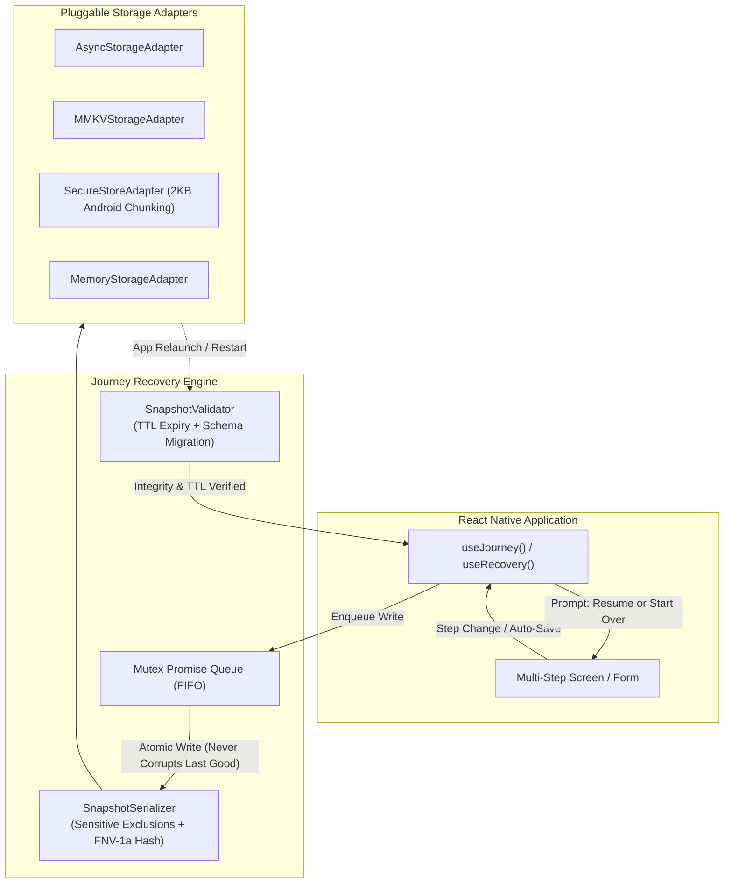

<div align="center">


# 🛡️ react-native-journey-recovery

### *Never make users start over.*

A developer-first journey recovery engine for React Native and Expo.  
Persist checkpoints, validate interrupted sessions, and safely restore unfinished multi-screen workflows on Android and iOS.

[](https://www.npmjs.com/package/react-native-journey-recovery)
[](LICENSE)
[](https://github.com/Imdvlpr99/react-native-journey-recovery/actions/workflows/ci.yml)
[](https://rn-journey-recovery.vercel.app/)
[](https://rn-journey-recovery.vercel.app/)
[](https://rn-journey-recovery.vercel.app/)
[](https://www.typescriptlang.org/)

[**Interactive Docs & Live Simulator**](https://rn-journey-recovery.vercel.app/) • [**API Reference**](docs/api-reference.md) • [**Architecture Blueprint**](REACT_NATIVE_JOURNEY_RECOVERY_PRODUCT_BLUEPRINT.md) • [**Example Apps**](examples/)

---

[](https://vercel.com/new/clone?repository-url=https%3A%2F%2Fgithub.com%2FImdvlpr99%2Freact-native-journey-recovery&project-name=react-native-journey-recovery-docs&repository-name=react-native-journey-recovery)

</div>

<br />

## 💡 The Problem

Mobile workflows—multi-step KYC onboarding, flight bookings, loan applications, e-commerce checkouts—are frequently interrupted:
- 📱 The OS forcefully terminates background processes (OOM / memory reclamation) without running JavaScript shutdown callbacks.
- ⚡ The user switches apps to check a two-factor SMS code or authenticator app.
- 🔋 The device battery dies, restarts, or the app encounters a crash.
- 📶 Connectivity drops mid-transaction.

Most developers try to solve this by dumping their entire global Redux or Zustand state to disk. This creates **massive storage bloat**, **accidental persistence of passwords and tokens**, and **fragile restore bugs** when backend truth changes.

`react-native-journey-recovery` provides a dedicated recovery layer with **explicit journey semantics**: registration, incremental checkpointing, FNV-1a integrity validation, TTL expiry, schema migration, and clean dismissal.

---

## 🏗️ Architecture & Recovery Lifecycle



---

## ⚖️ Why Journey Recovery vs Generic Persistence?

| Capability | Generic Store Persistence | `react-native-journey-recovery` |
|---|:---:|:---:|
| **Named Journey Semantics** | ❌ (Dumps entire store) | ✅ First-class (`useJourney('checkout')`) |
| **Write Race Protection** | ❌ (Prone to out-of-order writes) | ✅ Per-journey FIFO Mutex Queue |
| **Tamper & Corruption Detection**| ❌ (Blind `JSON.parse`) | ✅ Deterministic 32-bit FNV-1a Checksums |
| **Automatic Schema Migration** | ⚠️ (Complex root migrations) | ✅ Per-journey `migrate(oldData, oldVer)` |
| **Time-to-Live (TTL) Expiry** | ❌ (Stale data persists forever) | ✅ Configurable expiration timestamps |
| **Android Keystore Size Limit** | ❌ (Crashes on >2048B in SecureStore) | ✅ Automatic transparent chunking |
| **Multi-User Isolation** | ❌ (Shared device leakage) | ✅ Namespaced user scoping (`userId`) |
| **Server Truth Assumption** | ⚠️ (Assumes saved = completed) | ✅ UI-only progress (requires server re-check) |

---

## 📦 Installation

```bash
npm install react-native-journey-recovery
# or
yarn add react-native-journey-recovery
# or
pnpm add react-native-journey-recovery
```

### Peer Dependencies
- `react`: `>= 18.0.0`
- *(Optional)* `@react-native-async-storage/async-storage` for default persistent storage.
- *(Optional)* `react-native-mmkv` for ultra-fast synchronous storage.
- *(Optional)* `expo-secure-store` for hardware-backed encrypted storage.

---

## 🚀 Quick Start (In 3 Steps)

### Step 1: Wrap App with `RecoveryProvider`

```tsx
import React from 'react';
import { RecoveryProvider, AsyncStorageAdapter } from 'react-native-journey-recovery';
import AsyncStorage from '@react-native-async-storage/async-storage';
import { NavigationContainer } from '@react-navigation/native';

const storage = new AsyncStorageAdapter(AsyncStorage);

export default function App() {
  return (
    <RecoveryProvider
      storage={storage}
      options={{
        defaultExpiry: 24 * 60 * 60 * 1000, // 24-hour TTL
        autoSave: true,
        debounceMs: 500,
      }}
    >
      <NavigationContainer>{/* Your App Screens */}</NavigationContainer>
    </RecoveryProvider>
  );
}
```

### Step 2: Save Checkpoints in Your Screen

```tsx
import React, { useState } from 'react';
import { useJourney } from 'react-native-journey-recovery';

interface CheckoutState {
  step: 'shipping' | 'billing' | 'review';
  shippingAddress: Record<string, string>;
  paymentMethod: string;
}

export function CheckoutScreen() {
  const journey = useJourney<CheckoutState>('checkout-flow', {
    version: 1,
    expiry: 12 * 60 * 60 * 1000, // 12 hours
  });

  const [address, setAddress] = useState({});

  const handleNext = async (nextStepData: CheckoutState) => {
    // Checkpoint progress with sensitive field exclusions
    await journey.checkpoint(nextStepData, {
      exclude: ['cardNumber', 'cvv'],
    });
  };

  const handleFinalOrderSubmit = async () => {
    // Clear checkpoint once successfully completed on backend
    await journey.clear();
  };

  return <>{/* Checkout UI */}</>;
}
```

### Step 3: Offer Seamless Recovery on App Launch

Use pre-built UI primitives or build your own custom banner/dialog:

```tsx
import React from 'react';
import { RecoveryBanner, RecoveryModal, RecoveryBottomSheet } from 'react-native-journey-recovery';

export function HomeScreen({ navigation }) {
  return (
    <>
      {/* 1. Inline Prompt Banner */}
      <RecoveryBanner
        journeyId="checkout-flow"
        title="Resume your unfinished order?"
        onRestored={(savedState) => navigation.navigate('Checkout', savedState)}
      />

      {/* 2. Or a Centered Modal Dialog */}
      <RecoveryModal
        journeyId="kyc-verification"
        title="Resume Identity Verification?"
        onRestored={(savedState) => navigation.navigate('KYC', savedState)}
      />
    </>
  );
}
```

---

## 🧰 Key Features & Highlights

### 1. Hardware-Backed Encrypted Storage with 2KB Chunking
Expo's `expo-secure-store` throws exceptions on Android when storing values over 2048 bytes. `SecureStoreAdapter` automatically chunks large snapshots into sub-keys and reassembles them transparently:

```tsx
import * as SecureStore from 'expo-secure-store';
import { SecureStoreAdapter } from 'react-native-journey-recovery';

const storage = new SecureStoreAdapter(SecureStore, {
  chunkSize: 1800, // Safe chunking for Android Keystore
});
```

### 2. State & Form Integrations
Zero-boilerplate hooks for the React Native ecosystem:
- **React Hook Form:** `useJourneyForm('kyc', form, { autoSave: true })`
- **Formik:** `useJourneyFormik('signup', formik, { autoSave: true })`
- **Zustand Slices:** `useJourneyZustand('cart', useStore, (s) => s.cart)`
- **Redux Slices:** `useJourneyRedux('order', store, (s) => s.order)`
- **TanStack Query:** `createTanStackQueryCoordinator({ invalidateOnRestore: [['cart']] })`
- **Zod Validation:** `validate: createZodValidator(mySchema)`

### 3. CLI Inspection & Verification Tool
Debug and verify exported snapshots directly from your terminal or CI pipelines:

```bash
# Print detailed diagnostics report with FNV-1a checksum and byte size
npx journey-recovery inspect snapshot.json

# Automated CI check: exits with 0 if valid, 1 if corrupted/expired
npx journey-recovery verify snapshot.json

# Compute 32-bit FNV-1a checksum
npx journey-recovery checksum '{"step":"shipping","cartTotal":150}'
```

### 4. Zero-Mock Unit Testing Harness
Test your screens with an isolated in-memory recovery environment for Jest / Vitest:

```tsx
import { render, screen, fireEvent } from '@testing-library/react-native';
import { createTestRecoveryEnvironment } from 'react-native-journey-recovery/testing';

it('recovers form draft after simulated process kill', async () => {
  const env = createTestRecoveryEnvironment();

  // 1. Render and enter data
  const { unmount } = render(<env.Wrapper><MyScreen /></env.Wrapper>);
  fireEvent.changeText(screen.getByPlaceholderText('City'), 'Tokyo');
  await env.flushPending();

  // 2. Simulate process termination
  unmount();

  // 3. Relaunch app with identical storage
  render(<env.Wrapper><MyScreen /></env.Wrapper>);
  expect(await screen.findByText(/Resume where you left off/i)).toBeTruthy();
});
```

---

## ⚡ High-Throughput Benchmarks

Tested on standard Node.js runtime (v22):

| Operation | Throughput | Latency |
|---|:---:|:---:|
| **32-bit FNV-1a Checksum Calculation** | **~167,000 ops/sec** | `0.005 ms` |
| **Serialized Concurrent Checkpoint Writes (Mutex Queue)** | **~35,000 writes/sec** | `0.028 ms` |
| **Checkpoint Retrieval, Checksum & TTL Verification** | **~224,000 reads/sec** | `0.004 ms` |

Run benchmarks locally anytime:
```bash
npm run bench
```

---

## 📂 Standalone Example Projects

Explore fully runnable implementations in [`examples/`](examples/):

- ✈️ [**`examples/expo`**](examples/expo): Standalone runnable Expo app with multi-step flight booking and `RecoveryModal`. (`cd examples/expo && npm install && npx expo start`)
- 🔐 [**`examples/bare-react-native`**](examples/bare-react-native): Bare React Native project demonstrating multi-user scoping and secure Keychain persistence.
- 🛒 [**`examples/checkout-flow`**](examples/checkout-flow): Multi-screen React Navigation checkout with address, delivery, and payment steps.
- 🌐 [**`examples/simulator`**](examples/simulator): Interactive browser simulator for process kills (`SIGKILL`) and data tampering.

---

## 📚 Documentation & Resources

- 🌐 [**Official Documentation Website**](https://rn-journey-recovery.vercel.app/) (Live on Vercel)
- 📖 [**GitHub Pages Mirror**](https://imdvlpr99.github.io/react-native-journey-recovery/)
- 📑 [**Complete API Reference**](docs/api-reference.md)
- 🏛️ [**Architecture Decision Records (ADRs)**](docs/adr/)
- 📋 [**Product Blueprint**](REACT_NATIVE_JOURNEY_RECOVERY_PRODUCT_BLUEPRINT.md)
- 📝 [**Changelog**](CHANGELOG.md)
- 🛡️ [**Security Policy**](SECURITY.md)

---

## 🤝 Contributing

Contributions are welcome! Please check out [CONTRIBUTING.md](CONTRIBUTING.md) to get started.

```bash
# Clone the repository
git clone https://github.com/Imdvlpr99/react-native-journey-recovery.git

# Install dependencies
npm install

# Run tests with coverage
npm run test:coverage

# Run TypeScript typecheck
npm run typecheck

# Start docs dev server
npm run dev:docs
```

---

## 📄 License

Distributed under the MIT License. See [`LICENSE`](LICENSE) for more information.

<div align="center">
<sub>Crafted with ❤️ for the React Native & Expo developer community.</sub>
</div>
